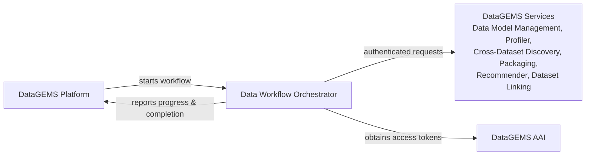

# Platform Integration

The Data Workflow Orchestrator doesn't work in isolation. It's the coordination layer between the DataGEMS platform, which decides *what* should happen to a dataset, and the DataGEMS services that do the work. This page describes how the orchestrator fits into the platform.

## Platform Processes

The DataGEMS platform manages each dataset's lifecycle as a *process* made of *steps*, such as onboarding, profiling and indexing. When a step needs a workflow, the platform starts the matching workflow in the orchestrator. The run parameters include:

- the dataset's identifier and any information the workflow needs, and
- `workflow_process_step_information`, which identifies the process and step that the run belongs to.

Users don't need to provide `workflow_process_step_information` themselves. The platform supplies it, and the orchestrator uses it to report back to the right step.

## Progress Reporting

While a platform-started workflow runs, each task reports its lifecycle events to the platform:

| Event | Reported step status |
| ----- | -------------------- |
| Task started | In progress |
| Task retrying | In progress |
| Task succeeded | In progress (or succeeded, for the workflow's final task) |
| Task skipped | In progress |
| Task failed | Failed |

Each report includes a summary of the task's execution, which lets the platform show detailed progress and help diagnose failures.

When the final task of a workflow succeeds, its success callback sends a completion notification for that kind of step (for example, onboarding complete or profiling complete). This notification is what moves the dataset forward: on receiving it, the platform starts the next workflow of the dataset's lifecycle. The workflows of a lifecycle therefore run one at a time, in a predetermined order, and never in parallel. If a workflow fails, no completion notification is sent and the next workflow isn't started. See [Workflow Overview](workflow-overview.md#available-workflows) for the order.

Scheduled workflows such as [Streaming Interval Profiling](workflow-streaming-interval-profiling.md) and [Weather Observations Ingestion](workflow-weather-ingestion.md) aren't part of a platform process, so they don't send these reports.

## Authentication

All requests from the orchestrator to other DataGEMS services are authenticated through the DataGEMS Authentication and Authorisation Infrastructure (AAI):

- The orchestrator authenticates as a service, with its own client credentials (OAuth 2.0 client credentials grant).
- It requests a separate access token for each target service, limited to that service's scope. Each workflow therefore gets only the access it needs.
- Tokens are reused while they're valid and renewed automatically before they expire.

The credentials are part of the deployment's protected configuration. See [Configuration](configuration.md).
