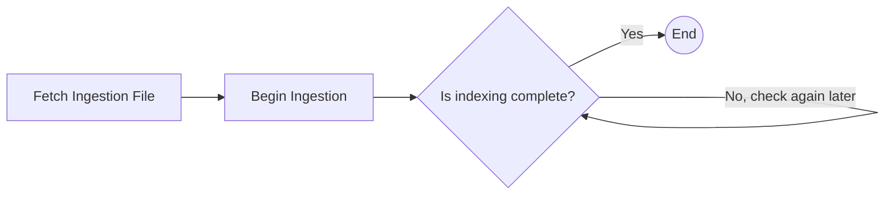

# Cross-Dataset Discovery Indexing Workflow

The Cross-Dataset Discovery Indexing Workflow (`CDD_INGEST`) adds a dataset to the index of the Cross-Dataset Discovery service, so that it can be found through discovery queries that span the platform's datasets.

The dataset must have been profiled before it can be indexed. See [Dataset Profiling](workflow-dataset-profiling.md). In a dataset's lifecycle, this is the last workflow of the chain: the platform starts it after [Recommender Registration](workflow-dataset-recommender.md) completes. See [Workflow Overview](workflow-overview.md#available-workflows).

## Input

| Parameter | Type | Format | Mandatory | Description |
| --------- | ---- | ------ | --------- | ----------- |
| id | string | uuid | yes | Identifier of the dataset to index. |
| workflow_process_step_information | object | | yes | Tracking information for the platform process step that this run belongs to. Supplied automatically by the platform. See [Platform Integration](integration.md). |

## Tasks

#### Fetch Ingestion File

This task asks the Profiler service for the location of the dataset's discovery profile, which was produced during profiling.
If the dataset has no discovery profile yet, the workflow stops with a failure that says the dataset hasn't been profiled.

#### Begin Ingestion

This task submits an indexing job for the discovery profile to the Cross-Dataset Discovery service, and returns the identifier of the job.

#### Wait for Completion

This task checks the indexing job's status at regular intervals until the job completes, releasing its worker slot between checks. If the job fails, the workflow stops with a failure.

## Completion

When indexing completes, the workflow notifies the platform that the dataset is available for cross-dataset discovery. This completes the dataset's lifecycle chain.
