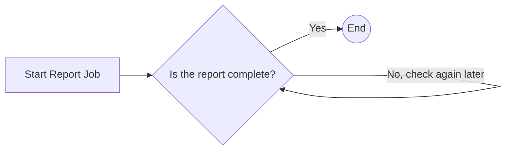

# Dataset Linking Report Workflow

The Dataset Linking Report Workflow (`DATASET_LINKING_REPORT`) asks the Dataset Linking service to produce a report on how similar datasets are, and how they could be linked, based on their keywords, descriptions and headlines.

## Input

All tuning parameters are optional. If a parameter isn't set, the Dataset Linking service uses its own default.

| Parameter | Type | Mandatory | Description |
| --------- | ---- | --------- | ----------- |
| id | string (uuid) | yes | Identifier of the dataset that the report is requested for. |
| kw | number | no | Weight of keyword similarity in the overall similarity score. |
| desc | number | no | Weight of description similarity in the overall similarity score. |
| head | number | no | Weight of headline similarity in the overall similarity score. |
| th | number (0–100) | no | Similarity threshold, as a percentage, that a pair of datasets must reach to be reported as related. |
| keyword_method | `jaccard` or `sbert` | no | Method used to compare keywords: set overlap (Jaccard) or semantic embeddings (SBERT). Defaults to `jaccard`. |
| include_chunks | boolean | no | Whether to include the matching parts of descriptions as evidence in the report. |
| include_graphs | boolean | no | Whether to generate graphs while the report is built. |
| graphs_only_above_threshold | boolean | no | Whether to generate graphs only for pairs that reach the threshold. |
| workflow_process_step_information | object | yes | Tracking information for the platform process step that this run belongs to. Supplied automatically by the platform. See [Platform Integration](integration.md). |

## Tasks

#### Start Report Job

This task submits a report job to the Dataset Linking service with the provided parameters, and returns the identifier of the job.

#### Wait for Completion

This task checks the report job's status at regular intervals until the job completes, releasing its worker slot between checks. If the job fails, the workflow stops with a failure.

## Completion

When the report is complete, the workflow notifies the platform, which can then retrieve the report from the Dataset Linking service.
