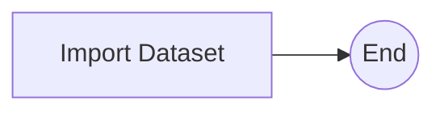

# Dataset Packaging Workflow

The Dataset Packaging Workflow (`DATASET_PACKAGING`) asks the Dataset Packaging service to package a dataset that's already on the platform, so it can be distributed and reused.

## Input

| Parameter | Type | Format | Mandatory | Description |
| --------- | ---- | ------ | --------- | ----------- |
| id | string | uuid | yes | Identifier of the dataset to package. |
| workflow_process_step_information | object | | yes | Tracking information for the platform process step that this run belongs to. Supplied automatically by the platform. See [Platform Integration](integration.md). |

## Tasks

#### Import Dataset

This task submits the dataset to the Dataset Packaging service. The service retrieves the dataset's information from the platform and handles the packaging itself.
If the request is rejected, the workflow stops with a failure.

## Completion

When the request is accepted, the workflow notifies the platform that the packaging step is complete.
