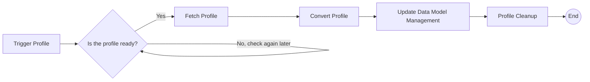

# Dataset Profiling Workflow

The Dataset Profiling Workflow (`DATASET_PROFILING`) runs the whole profiling process for an onboarded dataset. It asks the Profiler service to generate a profile, adds the result to the dataset's representation in Data Model Management, and then releases the profiling resources.

## Input

The workflow accepts the following parameters:

| Parameter | Type | Format | Mandatory | Description |
| --------- | ---- | ------ | --------- | ----------- |
| id | string | uuid | yes | Globally unique identifier of the dataset to profile. Profiling results are linked to the dataset through this identifier. |
| data_store_kind | integer | 0 or 1 | yes | How the dataset is stored: `0` for file-based storage, `1` for a relational database. Determines how the Profiler accesses the data. Defaults to `0`. |
| database_name | string | | when `data_store_kind` is `1` | Name of the database that holds the dataset. |
| name | string | | no | Human-readable name of the dataset. |
| description | string | | no | Detailed description of the dataset. |
| headline | string | | no | Short, high-level summary of the dataset. |
| keywords | array of strings | | no | Free-form keywords associated with the dataset. |
| fields_of_science | array of strings | | no | Scientific or domain classifications of the dataset. |
| languages | array of strings | | no | Languages represented in the dataset's content. Relevant when profiling textual data. |
| countries | array of strings | | no | Countries relevant to the dataset. |
| url | string | uri | no | Public URL where the dataset is published or described. |
| citeAs | string | | no | Recommended citation for the dataset. |
| conformsTo | string | | no | Standard, schema or specification that the dataset conforms to. |
| license | string | | no | License under which the dataset is distributed. |
| doi | string | | no | Digital Object Identifier of the dataset, if one exists. |
| date_published | string | date | no | Publication date of the dataset. Defaults to the current date. |
| archivedAt | string | | no | Location where the dataset is archived. |
| dataset_file_path | string | | no | Path to the dataset's files, when known. |
| userId | string | | no | Identifier of the user who requested profiling, used for attribution. |
| workflow_process_step_information | object | | yes | Tracking information for the platform process step that this run belongs to. Supplied automatically by the platform. See [Platform Integration](integration.md). |

## Tasks

#### Trigger Profile

This task submits a profiling job to the Profiler service. The request includes the dataset's descriptive metadata and a data connector that tells the Profiler how to reach the data:

- For **file-based** datasets, the Profiler finds the data from the dataset identifier.
- For **database-backed** datasets, the orchestrator finds the database server that hosts the named database in its configured list of database servers, and passes the connection details to the Profiler.

The task returns the identifier of the profiling job.

#### Wait for Completion

This task checks the profiling job's status at regular intervals until the profile is ready. Between checks it releases its worker slot, so long-running profiling jobs don't use execution resources.
If the job fails, or is no longer available, the workflow stops with a failure, so incomplete or invalid profiles never reach downstream systems.

#### Fetch Profile

When the profile is ready, this task retrieves it from the Profiler service unchanged, in its original structured (Croissant-based) form.

#### Convert Profile

This task converts the profile into the property-graph (PG-JSON) representation used by the DataGEMS metadata model (MoMa), using the MoMa management service.

#### Update Data Model Management

This task updates the dataset in the Data Model Management service. It combines the converted profile with the descriptive information from the original profile in a single update, along with provenance for the profiling operation. When this step succeeds, the dataset's profile is available on the platform.

#### Profile Cleanup

After the profile has been safely stored, this task asks the Profiler service to release the resources of the profiling job.
Cleanup runs only after the results are stored, so no information is lost.

## Completion

When cleanup finishes, the workflow notifies the platform that profiling is complete. The dataset can then move on to later steps such as [Cross-Dataset Discovery Indexing](workflow-cross-dataset-discovery.md).
