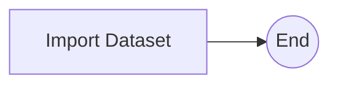

# Recommender Registration Workflow

The Recommender Registration Workflow (`DATASET_RECOMMENDATION_REGISTERING`) registers a dataset with the Dataset Recommender service, so that the dataset can be recommended to platform users.

## Input

| Parameter | Type | Format | Mandatory | Description |
| --------- | ---- | ------ | --------- | ----------- |
| id | string | uuid | yes | Identifier of the dataset to register. |
| workflow_process_step_information | object | | yes | Tracking information for the platform process step that this run belongs to. Supplied automatically by the platform. See [Platform Integration](integration.md). |

## Tasks

#### Import Dataset

This task submits the dataset to the Dataset Recommender service, which retrieves the dataset's information from the platform and adds the dataset to its recommendation catalogue.
If the request is rejected, the workflow stops with a failure.

## Completion

When registration succeeds, the workflow notifies the platform that the recommender registration step is complete.
