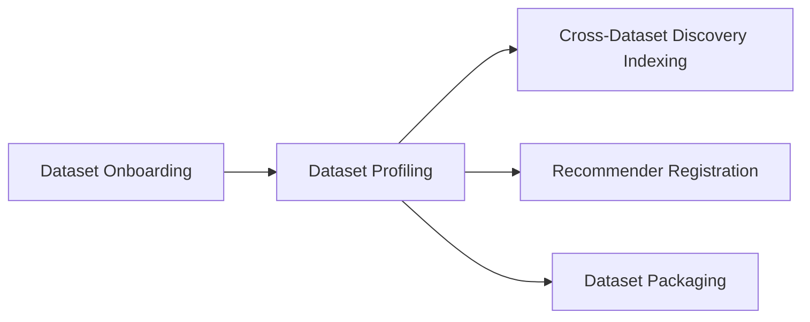

# Workflow Overview

The Data Workflow Orchestrator hosts the data management workflows of the DataGEMS platform. Each workflow is an Airflow DAG that coordinates one or more DataGEMS services to complete a step of a dataset's lifecycle, from making the data available to profiling, indexing and packaging it.

## Available Workflows

| Workflow | DAG ID | Started by | Purpose |
| -------- | ------ | ---------- | ------- |
| [Dataset Onboarding](workflow-dataset-onboarding.md) | `DATASET_ONBOARDING` | Platform | Brings a dataset's files into the platform's storage and registers the dataset and its metadata in Data Model Management. |
| [Dataset Profiling](workflow-dataset-profiling.md) | `DATASET_PROFILING` | Platform | Generates a profile of an onboarded dataset and enriches its representation in Data Model Management. |
| [Cross-Dataset Discovery Indexing](workflow-cross-dataset-discovery.md) | `CDD_INGEST` | Platform | Indexes a profiled dataset in the Cross-Dataset Discovery service so it can be found through discovery queries. |
| [Dataset Packaging](workflow-dataset-packaging.md) | `DATASET_PACKAGING` | Platform | Asks the Dataset Packaging service to package a dataset. |
| [Recommender Registration](workflow-dataset-recommender.md) | `DATASET_RECOMMENDATION_REGISTERING` | Platform | Registers a dataset with the Dataset Recommender service. |
| [Dataset Linking Report](workflow-dataset-linking-report.md) | `DATASET_LINKING_REPORT` | Platform | Produces a report of similarities and links between datasets. |
| [Streaming Interval Profiling](workflow-streaming-interval-profiling.md) | `STREAMING_INTERVAL_PROFILING` | Schedule | Keeps the metadata of a continuously updated dataset in sync with its latest data interval. |
| [Weather Observations Ingestion](workflow-weather-ingestion.md) | `GEO_INGEST` | Schedule | Collects weather station observations for use-case datasets. |

The typical lifecycle of a newly contributed dataset chains several of these workflows:

The platform decides which steps run, and in what order, for each dataset. Each workflow only performs its own step.

## Common Behaviour

All workflows share the following characteristics:

- **Parameterised runs**: each run receives its inputs as run parameters. The parameters of each workflow are listed on its page.
- **Authenticated service calls**: every call to another DataGEMS service is authenticated on behalf of the orchestrator. See [Platform Integration](integration.md).
- **Status reporting**: workflows started by the platform report the progress of each task back to it, so the dataset's status can be followed from the platform. See [Platform Integration](integration.md).
- **Efficient waiting**: when a workflow waits for a long-running job in another service (for example a profiling or indexing job), it checks the job's status at regular intervals. Between checks it releases its worker slot, so waiting doesn't consume execution resources.
- **Fail-fast execution**: if a step can't be completed, the workflow stops and is marked as failed instead of continuing with incomplete results.

## Starting a Workflow

Platform workflows are normally started by the DataGEMS platform as part of its dataset management processes. Authorised operators can also start them from the Airflow UI or through the [Airflow REST API](https://airflow.apache.org/docs/apache-airflow/stable/stable-rest-api-ref.html), passing the workflow parameters as the run configuration (`conf`).

Scheduled workflows run automatically at their configured interval and take no parameters.
