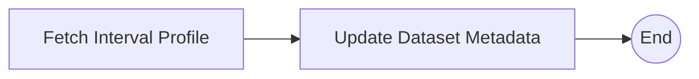

# Streaming Interval Profiling Workflow

The Streaming Interval Profiling Workflow (`STREAMING_INTERVAL_PROFILING`) keeps the metadata of a continuously updated (streaming) dataset in line with its most recent data.
It runs on a schedule. At each run it gets a profile of the latest data interval and applies the changes to the dataset's representation in Data Model Management.

## Schedule and Input

The workflow runs automatically **every hour** and takes no run parameters. The dataset it monitors is set in the orchestrator's [configuration](configuration.md).

## Tasks

#### Fetch Interval Profile

This task asks the Streaming Interval Profiler service to profile the latest interval of the monitored dataset. The response describes the changes to apply to the dataset's metadata: updated properties of existing metadata elements, and new elements to add.

#### Update Dataset Metadata

This task retrieves the dataset's current representation from the Data Model Management service and applies the reported changes:

- properties of existing elements are replaced with their updated values,
- new elements and the relationships between them are added.

The updated representation is then sent back to Data Model Management.

## Status Reporting

This workflow runs on a schedule, not as part of a platform process, so it doesn't report step status to the platform. Its runs can be followed in the Airflow UI.
