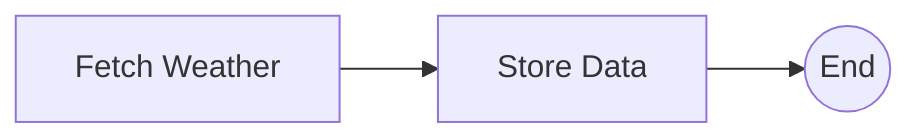

# Weather Observations Ingestion Workflow

The Weather Observations Ingestion Workflow (`GEO_INGEST`) collects observations from a network of meteorological stations and stores them in a time-series database. Over time it builds a continuously growing dataset for DataGEMS use cases that rely on weather data.

## Schedule and Input

The workflow runs automatically **every 10 minutes** and takes no run parameters. The observation source and the target database are set in the orchestrator's [configuration](configuration.md).

## Tasks

#### Fetch Weather

This task retrieves the latest station observations from the meteorological data provider, as a GeoJSON feature collection. Each feature describes one station (its identifier, name and coordinates) and its latest measurements, such as temperature, humidity, pressure, rainfall and wind.

#### Store Data

This task stores the retrieved data in the time-series database:

- **Stations** are created or updated, so station information stays current.
- **Observations** are appended. Observations that are already stored are ignored, so overlapping collections never create duplicates.

The outcome of each collection is also recorded, so the completeness of the collected data can be monitored.

See [Data Stores](datastore.md) for more on the time-series database.

## Status Reporting

This workflow runs on a schedule, not as part of a platform process, so it doesn't report step status to the platform. Its runs can be followed in the Airflow UI.
